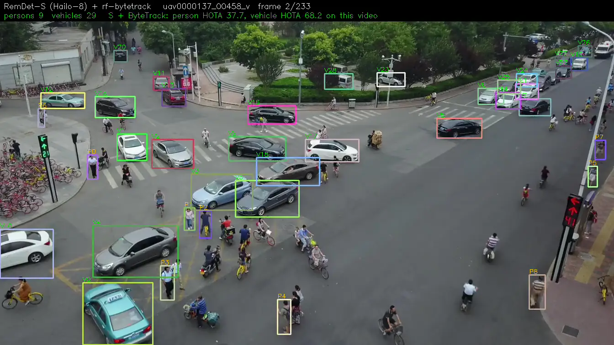
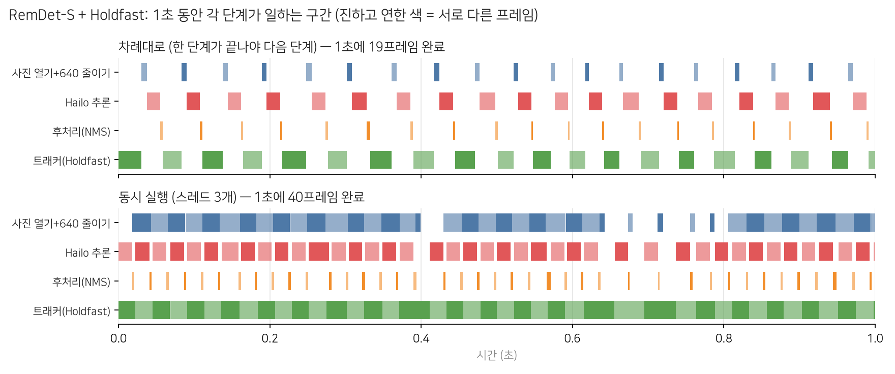
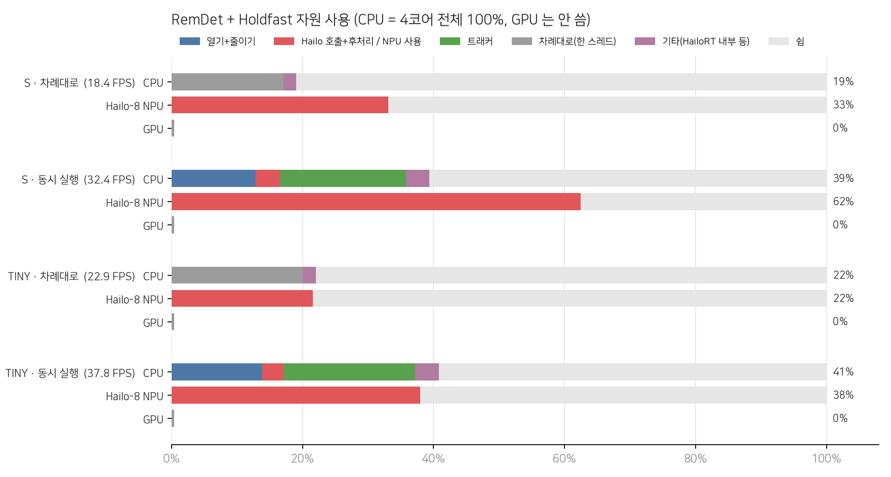
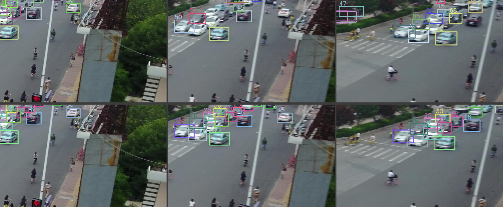
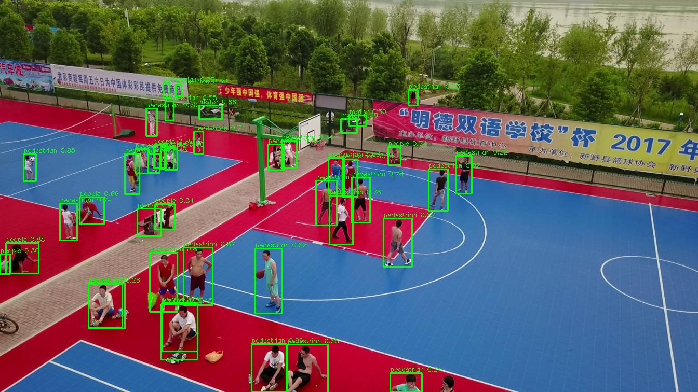

<div align="center">

# hailo-drone-mot

**Raspberry Pi 5 + Hailo-8 위에서 돌아가는 실시간 드론 항공영상 다중 객체 추적(MOT)**




<sub>RemDet-S (Hailo-8) + ByteTrack, VisDrone `uav0000137_00458_v` · [원본 영상](docs/assets/demo.mp4)</sub>

</div>

---

## 개요

고정익 드론에 실을 수 있는 작은 엣지 보드에서 **항공영상 속 사람과 차량을 실시간으로 검출하고 추적**하는 것이 목표입니다.

- **검출기:** [RemDet](https://github.com/HZAI-ZJNU/RemDet) (tiny / s / m / l), VisDrone으로 학습한 뒤 Hailo-8용 INT8 HEF로 변환
- **추적기:** 범용 트래커 13종과 드론 전용 트래커 6종을 같은 조건에서 비교
- **평가:** VisDrone2019-MOT val 7개 시퀀스에서 HOTA / IDF1 / IDSW 측정, **Pi 위에서 측정한 실제 E2E FPS** 함께 기록

```
카메라 프레임 ─▶ 리사이즈(640) ─▶ Hailo-8: RemDet(INT8) ─▶ CPU: decode + NMS ─▶ CPU: 트래커 ─▶ ID가 붙은 박스
```

**Hailo 변환/경량화 방법은 [Hailo DFC 가이드](docs/hailo_dfc_guide.md)에 정리했습니다.**

---

## 결과

### 검출기 속도 (Raspberry Pi 5 + Hailo-8)

| 모델 | 추론 FPS | 실제 FPS (사진 읽기~후처리) |
|---|---:|---:|
| RemDet-Tiny | 103 | **75** |
| RemDet-S | 56 | **46** |
| RemDet-M | 26 | 23 |
| RemDet-L | 13 | 12.5 |

### 트래커 비교 (사람·차 함께 추적, 단계 동시 실행)

모든 트래커를 같은 조건으로 측정했습니다. 사람과 차를 트래커 하나로 함께 추적하고, 사진 읽기 / Hailo 추론 / 트래커를 스레드 3개로 동시에 돌립니다. E2E FPS는 영상 디코딩부터 트래커까지 전부 포함한 속도이고, Pi에서 다른 작업 없이 7개 영상 전체로 쟀습니다.

**RemDet-S**

| 트래커 | 종류 | 통합 HOTA | 사람 HOTA | 차량 HOTA | IDF1 | E2E FPS (차례대로) | E2E FPS (동시 실행) |
|---|---|---:|---:|---:|---:|---:|---:|
| **Holdfast** | 드론 전용 | **47.2** | 39.6 | 54.5 | 58.8 | 20.4 | **32.4** |
| SFTrack | 드론 전용 | 45.3 | 37.3 | 53.0 | 56.9 | 7.5 | 8.4 |
| BoT-SORT + CMC | 범용 | 44.9 | 35.5 | 53.6 | 56.2 | 17.4 | 19.7 |
| C-BIoU | 범용 | 44.6 | 35.5 | 53.1 | 54.7 | 39.1 | 37.0 |
| ByteTrack (roboflow) | 범용 | 44.5 | 35.7 | 52.9 | 54.6 | 40.6 | 36.2 |
| McByte | 범용 | 43.6 | 34.3 | 52.2 | 53.3 | 37.7 | 38.0 |
| SORT | 범용 | 36.2 | 29.3 | 43.2 | 39.4 | 35.8 | 36.1 |

**RemDet-Tiny**

| 트래커 | 종류 | 통합 HOTA | 사람 HOTA | 차량 HOTA | IDF1 | E2E FPS (차례대로) | E2E FPS (동시 실행) |
|---|---|---:|---:|---:|---:|---:|---:|
| **Holdfast** | 드론 전용 | **44.3** | 33.7 | 53.8 | 54.3 | 25.9 | **37.8** |
| SFTrack | 드론 전용 | 42.1 | 31.2 | 51.9 | 52.0 | 9.1 | 9.8 |
| ByteTrack (roboflow) | 범용 | 41.5 | 30.9 | 50.9 | 48.8 | 48.8 | 53.6 |
| C-BIoU | 범용 | 40.7 | 28.5 | 51.4 | 47.9 | 42.9 | 51.4 |
| BoT-SORT + CMC | 범용 | 40.7 | 28.0 | 51.6 | 49.0 | 19.2 | 25.9 |

<sub>트래커 19개 전체 표: [`mot/pipeline_tables.md`](mot/pipeline_tables.md). 사람·차를 함께 돌린 HOTA는 따로 돌렸을 때와 모든 트래커에서 0.4 이내로 같았습니다.</sub>

**정리하면:** 단계를 동시에 돌리면 **Holdfast가 S·Tiny 모두 통합 HOTA 1위이면서 30 FPS를 넘습니다** (S 32.4, Tiny 37.8 FPS). 차례대로 돌릴 때는 Holdfast의 카메라 움직임 보정(CMC)을 기다리느라 20 FPS대였습니다. 가벼운 트래커(C-BIoU, ByteTrack)는 원래 사진 읽기·Hailo 단계에서 막혀 있어서 동시 실행으로 거의 빨라지지 않고, 무거운 트래커(SFTrack, BoT-SORT + CMC)는 트래커 자체가 30 FPS보다 느려 그대로입니다.

<p align="center">
  
</p>

### 자원 사용 (RemDet-S + Holdfast)

| 장치 | 차례대로 | 동시 실행 (32.4 FPS) |
|---|---:|---:|
| CPU (4코어 전체 = 100%) | 19% | 39% (사진 읽기 13%, Hailo 호출+후처리 4%, 트래커 19%, 기타 4%) |
| Hailo-8 NPU (추론 중인 시간) | 33% | 62% |
| GPU | 0% (안 씀) | 0% (안 씀) |
| 메모리 / 최고 온도 | | 3.0 GB / 70°C |

<p align="center">
  
</p>

<details>
<summary>정성 비교: ByteTrack(위) vs Holdfast(아래)</summary>



</details>

<details>
<summary>RemDet-S 검출 예시</summary>



</details>

---

## 구조

```
.
├── remdet_bench.py / remdet_eval.py   Hailo에서 RemDet 속도·mAP 측정
├── remdet_live.py / remdet_track.py   실시간 검출·추적 데모
├── remdet_mot.py                      MOT 평가 (단일 트래커)
├── docs/
│   └── hailo_dfc_guide.md             ONNX → HEF 변환 가이드
└── mot/
    ├── common.py          경로, 시퀀스, 클래스 그룹(사람/차량) 정의
    ├── dump_dets.py       검출 결과 캐시 (Hailo 필요)
    ├── run_trackers.py    트래커 일괄 실행
    ├── evaluate.py        TrackEval 기반 HOTA/IDF1 평가
    ├── e2e_bench.py       Pi에서 E2E FPS 측정 (단계를 차례대로)
    ├── e2e_pipeline_all.py  Pi에서 E2E FPS·자원 측정 (단계 동시 실행, 사람·차 함께)
    ├── ext_trackers.py    드론 전용 트래커 어댑터
    └── ext/               드론 전용 트래커 구현 (원저자 코드 수정)
```

## 실행

```bash
# 0) 준비: HailoRT 설치, VisDrone2019-MOT val 다운로드, HEF를 models/ 에 배치
# 1) 검출 결과 캐시
python mot/dump_dets.py
# 2) 트래커 실행
python mot/run_trackers.py --dets tiny s --trackers rf-bytetrack cbiou ocsort --jobs 4
# 3) 평가
python mot/evaluate.py
# 4) Pi에서 E2E FPS·자원 측정 (단계 동시 실행, 사람·차 함께; Hailo 필요)
python mot/e2e_pipeline_all.py --model s --trackers holdfast rf-bytetrack cbiou
python mot/make_pipeline_table.py   # -> mot/pipeline_tables.md
```

**환경:** Raspberry Pi 5 (8GB), Hailo-8 (M.2), HailoRT, Python 3, [boxmot](https://github.com/mikel-brostrom/boxmot), [trackers](https://github.com/roboflow/trackers), [TrackEval](https://github.com/JonathonLuiten/TrackEval)

> 학습 가중치, HEF, 데이터셋은 저장소에 포함하지 않습니다.

---

## 참고

- 데이터셋: [VisDrone](https://github.com/VisDrone/VisDrone-Dataset) (비상업적 연구용)
- 검출기: [RemDet](https://github.com/HZAI-ZJNU/RemDet)
- `mot/ext/` 아래 트래커들은 각 원저자의 공개 구현을 어댑터용으로 수정한 것이며, 원래 저장소의 라이선스를 따릅니다.
