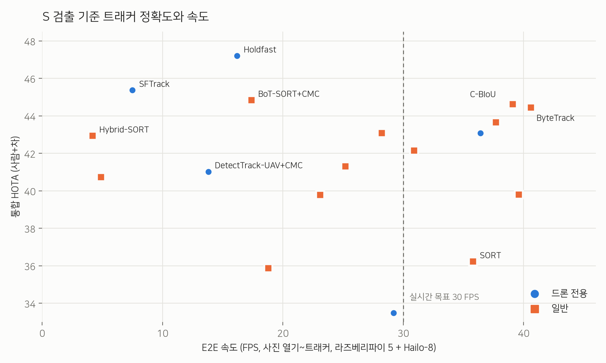

<div align="center">

# hailo-drone-mot

**Raspberry Pi 5 + Hailo-8 위에서 돌아가는 실시간 드론 항공영상 다중 객체 추적(MOT)**


<sub>RemDet-S (Hailo-8) + ByteTrack, VisDrone `uav0000137_00458_v` · [원본 영상](docs/assets/demo.mp4)</sub>

</div>

---

## 개요

고정익 드론에 실을 수 있는 작은 엣지 보드에서 **항공영상 속 사람과 차량을 실시간으로 검출하고 추적**하는 것이 목표입니다.

- **검출기:** [RemDet](https://github.com/HZAI-ZJNU/RemDet) (tiny / s / m / l), VisDrone으로 학습한 뒤 Hailo-8용 INT8 HEF로 변환
- **추적기:** 범용 트래커 13종과 드론 전용 트래커 6종을 같은 조건에서 비교
- **평가:** VisDrone2019-MOT val 7개 시퀀스에서 HOTA / IDF1 / IDSW 측정, **Pi 위에서 측정한 실제 E2E FPS** 함께 기록

```
카메라 프레임 ─▶ 리사이즈(640) ─▶ Hailo-8: RemDet(INT8) ─▶ CPU: decode + NMS ─▶ CPU: 트래커 ─▶ ID가 붙은 박스
```

**Hailo 변환/경량화 방법은 [Hailo DFC 가이드](docs/hailo_dfc_guide.md)에 정리했습니다.**

---

## 결과

### 검출기 속도 (Raspberry Pi 5 + Hailo-8)

| 모델 | 추론 FPS | 실제 FPS (사진 읽기~후처리) |
|---|---:|---:|
| RemDet-Tiny | 103 | **75** |
| RemDet-S | 56 | **46** |
| RemDet-M | 26 | 23 |
| RemDet-L | 13 | 12.5 |

### 트래커 비교 (RemDet-S 검출 기준)

| 트래커 | 종류 | 통합 HOTA | 사람 HOTA | 차량 HOTA | IDF1 | E2E FPS |
|---|---|---:|---:|---:|---:|---:|
| Holdfast | 드론 전용 | **47.2** | 39.6 | 54.5 | 58.8 | 16.2 |
| SFTrack | 드론 전용 | 45.4 | 37.4 | 53.1 | 57.1 | 7.5 |
| BoT-SORT + CMC | 범용 | 44.8 | 35.5 | 53.6 | 56.1 | 17.4 |
| C-BIoU | 범용 | 44.6 | 35.5 | 53.1 | 54.7 | 39.1 |
| ByteTrack (roboflow) | 범용 | 44.5 | 35.8 | 52.7 | 54.4 | **40.6** |
| McByte | 범용 | 43.7 | 34.3 | 52.2 | 53.3 | 37.7 |
| SORT | 범용 | 36.2 | 29.3 | 43.2 | 39.5 | 35.8 |

<sub>E2E FPS = 영상 디코딩부터 트래커까지 전부 포함한 속도, Pi에서 다른 작업 없이 측정. 전체 표: [`mot/all_metrics2.md`](mot/all_metrics2.md)</sub>

<p align="center">
  
</p>

**정리하면:** 실시간(30 FPS 이상) 구간에서는 **ByteTrack과 C-BIoU**가 정확도와 속도의 균형이 가장 좋습니다. 드론 전용 트래커(Holdfast, SFTrack)는 정확도는 가장 높지만 카메라 움직임 보정(CMC) 때문에 CPU에서 느립니다.

<details>
<summary>정성 비교: ByteTrack(위) vs Holdfast(아래)</summary>


</details>

<details>
<summary>RemDet-S 검출 예시</summary>


</details>

---

## 구조

```
.
├── remdet_bench.py / remdet_eval.py   Hailo에서 RemDet 속도·mAP 측정
├── remdet_live.py / remdet_track.py   실시간 검출·추적 데모
├── remdet_mot.py                      MOT 평가 (단일 트래커)
├── docs/
│   └── hailo_dfc_guide.md             ONNX → HEF 변환 가이드
└── mot/
    ├── common.py          경로, 시퀀스, 클래스 그룹(사람/차량) 정의
    ├── dump_dets.py       검출 결과 캐시 (Hailo 필요)
    ├── run_trackers.py    트래커 일괄 실행
    ├── evaluate.py        TrackEval 기반 HOTA/IDF1 평가
    ├── e2e_bench.py       Pi에서 E2E FPS 측정
    ├── ext_trackers.py    드론 전용 트래커 어댑터
    └── ext/               드론 전용 트래커 구현 (원저자 코드 수정)
```

## 실행

```bash
# 0) 준비: HailoRT 설치, VisDrone2019-MOT val 다운로드, HEF를 models/ 에 배치
# 1) 검출 결과 캐시
python mot/dump_dets.py
# 2) 트래커 실행
python mot/run_trackers.py --dets tiny s --trackers rf-bytetrack cbiou ocsort --jobs 4
# 3) 평가
python mot/evaluate.py
```

**환경:** Raspberry Pi 5 (8GB), Hailo-8 (M.2), HailoRT, Python 3, [boxmot](https://github.com/mikel-brostrom/boxmot), [trackers](https://github.com/roboflow/trackers), [TrackEval](https://github.com/JonathonLuiten/TrackEval)

> 학습 가중치, HEF, 데이터셋은 저장소에 포함하지 않습니다.

---

## 참고

- 데이터셋: [VisDrone](https://github.com/VisDrone/VisDrone-Dataset) (비상업적 연구용)
- 검출기: [RemDet](https://github.com/HZAI-ZJNU/RemDet)
- `mot/ext/` 아래 트래커들은 각 원저자의 공개 구현을 어댑터용으로 수정한 것이며, 원래 저장소의 라이선스를 따릅니다.
