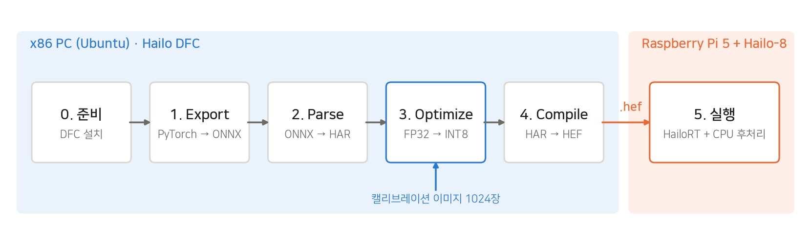
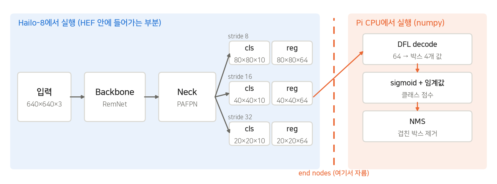
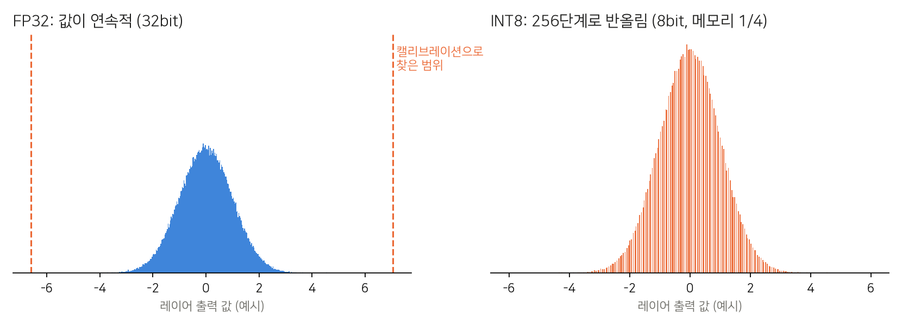
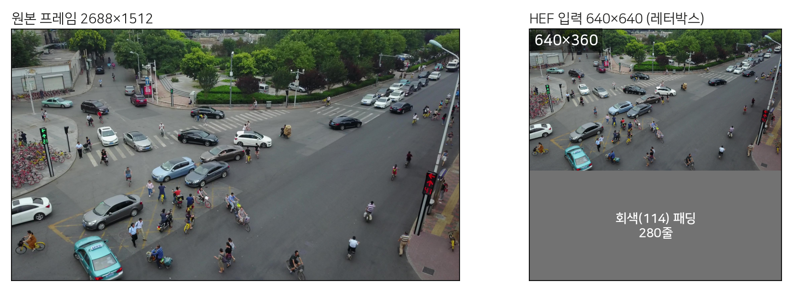
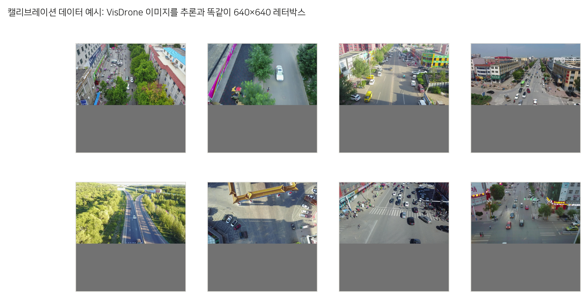

# Hailo DFC 따라하기: RemDet ONNX → HEF

Hailo-8에서 모델을 돌리려면 **HEF**(Hailo Executable Format) 파일이 필요합니다. HEF는 Hailo의 **Dataflow Compiler(DFC)** 로 만듭니다. 이 과정에서 FP32 모델이 **INT8로 양자화**되고 Hailo-8 칩 구조에 맞게 배치됩니다. 이 프로젝트에서 말하는 "경량화"가 바로 이 과정입니다.

> 이 문서는 Hailo 공식 문서를 참고해 작성했습니다.
> - [Hailo Dataflow Compiler User Guide](https://hailo.ai/developer-zone/documentation/) (Developer Zone, 로그인 필요)
> - [Hailo Model Zoo: Getting Started](https://github.com/hailo-ai/hailo_model_zoo/blob/master/docs/GETTING_STARTED.rst)
> - [HailoRT](https://github.com/hailo-ai/hailort)
>
> 구성은 DFC에 들어 있는 공식 튜토리얼(Parsing → Model Optimization → Compilation → Inference)과 같은 순서입니다.
> DFC 버전마다 옵션 이름이 조금씩 다르니 실제로 쓰기 전에 `hailo <명령> --help`로 확인하세요.



## 한눈에 보기

| 단계 | 어디서 | 이 단계가 하는 일 | 입력 → 결과물 | 실행할 것 |
|---|---|---|---|---|
| 0. 준비 | PC | DFC를 설치합니다. DFC는 x86 리눅스에서만 돌아갑니다. | wheel → `hailo` 명령 | `pip install` |
| 1. Export | PC | 학습한 PyTorch 모델을 표준 형식인 ONNX로 바꿉니다. Hailo가 못 하는 후처리는 이때 잘라냅니다. | `.pth` → `.onnx` | `dfc/export_onnx.py` |
| 2. Parse | PC | ONNX를 Hailo 내부 형식으로 번역합니다. 아직 FP32이고, 지원하지 않는 레이어가 있으면 여기서 오류가 납니다. | `.onnx` → `.har` | `hailo parser` |
| 3. Optimize | PC | 실제 이미지를 넣어 각 레이어 값의 범위를 재고, 그 범위에 맞춰 FP32를 INT8로 바꿉니다. 정확도가 여기서 결정됩니다. | `.har` + 캘리브레이션 → `_optimized.har` | `hailo optimize` |
| 4. Compile | PC | INT8 모델을 Hailo-8의 연산 유닛과 메모리에 배치하고 실행 파일을 만듭니다. 속도가 여기서 결정됩니다. | `_optimized.har` → `.hef` | `hailo compiler` |
| 5. 실행 | Pi | HEF를 Hailo-8에 올려 추론하고, 잘라낸 후처리는 CPU에서 합니다. | `.hef` → 박스 | `hailortcli`, `remdet_bench.py` |

`.har`(Hailo Archive)는 DFC 중간 결과를 담는 파일입니다. 단계마다 저장되기 때문에 실패한 단계부터 다시 시작할 수 있습니다.

---

## 0단계. 준비: DFC 설치

**이 단계는?** DFC는 Hailo가 배포하는 Python 패키지(wheel)입니다. 라즈베리파이(ARM)에서는 설치되지 않으므로 **x86_64 Ubuntu PC**가 필요합니다. GPU가 있으면 3단계 양자화 보정을 더 강하게 걸 수 있습니다.

**필요한 것**

| 항목 | 권장 |
|---|---|
| OS | Ubuntu 22.04 (x86_64) |
| Python | 3.10 |
| RAM | 16GB 이상 (캘리브레이션 1024장이 메모리에 약 5GB 올라갑니다) |
| GPU | 있으면 좋음. 없으면 최적화 레벨이 자동으로 낮아집니다. ([커뮤니티](https://community.hailo.ai/t/custom-model-for-raspberry-pi-5-fails-on-hailo-dataflow-compiler/2704)) |
| DFC 버전 | Hailo-8은 **v3.x**. Pi의 HailoRT 버전과 맞춥니다. 이 프로젝트의 Pi는 HailoRT **4.23**이므로 **DFC 3.33**을 씁니다. ([Ultralytics](https://docs.ultralytics.com/integrations/hailo)) |

**따라하기**

1. [Hailo Developer Zone](https://hailo.ai/developer-zone/software-downloads/)에 가입하고 로그인합니다.
2. Software Downloads에서 `Dataflow Compiler`, `Python 3.10`, `x86_64` 조건으로 wheel 파일을 받습니다.
3. PC 터미널에서 실행합니다.

```bash
# 시스템 패키지 (pygraphviz 빌드에 필요)
sudo apt update
sudo apt install -y python3.10 python3.10-dev python3.10-venv python3-tk graphviz libgraphviz-dev build-essential

# 가상환경
python3.10 -m venv ~/dfc-venv
source ~/dfc-venv/bin/activate
pip install --upgrade pip

# DFC 설치 (받은 파일 이름에 맞게)
pip install ./hailo_dataflow_compiler-3.33.0-py3-none-linux_x86_64.whl
```

**확인**

```bash
hailo --version
hailo --help        # parser / optimize / compiler / profiler 명령이 보이면 성공
```

> `pygraphviz` 빌드 오류가 나면 `graphviz`, `libgraphviz-dev`, `build-essential`이 설치됐는지 확인하세요. ([커뮤니티](https://community.hailo.ai/t/installation-of-dataflow-compiler-failed-on-debian-12-7-pyenv-for-python3-10/5492))
> `hailo tutorial`을 실행하면 Hailo 공식 튜토리얼 노트북(Jupyter)도 열 수 있습니다.

---

## 1단계. Export: PyTorch → ONNX

**이 단계는?** 학습 코드(RemDet, mmdet 기반)에 묶여 있는 모델을 표준 형식인 ONNX 파일 하나로 꺼냅니다. 이때 **어디까지를 Hailo에 맡길지** 정합니다.



- **Hailo에 넣는 부분:** backbone, neck, 그리고 스케일별 `cls` conv와 `reg` conv까지입니다. 출력은 6개입니다.
- **CPU에 남기는 부분:** DFL decode(64채널을 박스 4개 값으로 변환), sigmoid, NMS입니다. 이런 연산은 INT8로 바꾸면 오차가 커지거나 NPU에서 지원되지 않습니다.
- **입력 크기:** `1×3×640×640`으로 고정합니다.

**따라하기** (RemDet 학습 환경이 있는 PC, `RemDet` 폴더에서)

```bash
pip install onnx onnxsim
python ~/hailo-test/dfc/export_onnx.py \
    config_remdet/remdet/remdet_s-300e_visdrone.py \
    work_dirs/remdet_s/best.pth \
    remdet_s.onnx
python -m onnxsim remdet_s.onnx remdet_s.onnx      # 그래프 단순화 (선택)
```

`dfc/export_onnx.py`의 핵심은 아래와 같습니다. 헤드의 마지막 conv까지만 실행하고 그 결과를 그대로 내보냅니다.

```python
def forward(self, x):
    feats = self.m.neck(self.m.backbone(x))
    outs = []
    for f, cls, reg in zip(feats, self.h.cls_preds, self.h.reg_preds):
        outs += [cls(f), reg(f)]
    return tuple(outs)
```

**확인:** 출력이 6개이고 모양이 아래와 같으면 됩니다. [Netron](https://netron.app)에 ONNX를 끌어다 놓으면 그래프로도 볼 수 있습니다.

```bash
python -c "import onnx; m=onnx.load('remdet_s.onnx'); [print(o.name, [d.dim_value for d in o.type.tensor_type.shape.dim]) for o in m.graph.output]"
```
```
cls_p3 [1, 10, 80, 80]
reg_p3 [1, 64, 80, 80]
cls_p4 [1, 10, 40, 40]
reg_p4 [1, 64, 40, 40]
cls_p5 [1, 10, 20, 20]
reg_p5 [1, 64, 20, 20]
```

---

## 2단계. Parse: ONNX → HAR

**이 단계는?** ONNX 그래프를 Hailo가 이해하는 내부 표현으로 번역합니다. 결과는 아직 FP32이고 칩에 올라갈 수 있는 형태도 아닙니다. **지원하지 않는 레이어가 있으면 여기서 오류가 나므로**, 모델이 Hailo에서 돌아갈 수 있는지 처음 확인하는 단계입니다.

**따라하기** (CLI)

```bash
source ~/dfc-venv/bin/activate
hailo parser onnx remdet_s.onnx --hw-arch hailo8
```

- 1단계에서 이미 헤드 끝에서 잘랐기 때문에 끝 노드를 따로 지정하지 않아도 됩니다.
- 파서가 "추천하는 끝 노드로 다시 파싱할까요? (y/n)"라고 물으면 `n`을 입력하세요. 추천 위치에는 NMS 같은 후처리가 포함될 수 있습니다.
- 실행이 끝나면 `remdet_s.har`이 생깁니다.

Python으로 하려면 `dfc/compile_hef.py`의 이 부분입니다.

```python
runner = ClientRunner(hw_arch="hailo8")
runner.translate_onnx_model("remdet_s.onnx", "remdet_s_visdrone", net_input_shapes={"images": [1, 3, 640, 640]})
runner.save_har("remdet_s_visdrone_parsed.har")
```

**확인**

```bash
hailo visualizer remdet_s.har      # 파싱된 그래프를 SVG로 확인
```

---

## 3단계. Optimize: FP32 → INT8 양자화

**이 단계는?** 실제 이미지(캘리브레이션 데이터)를 모델에 넣어 **각 레이어 값이 어느 범위에 있는지** 측정합니다. 그 범위를 256단계(8bit)로 나눠 FP32 값을 반올림합니다. 메모리와 연산량이 크게 줄지만 반올림 오차가 생기므로, **최종 정확도가 이 단계에서 결정됩니다.**



### 3-1. 캘리브레이션 데이터 만들기

**전처리를 Pi에서 추론할 때와 똑같이** 해야 합니다. 그래야 측정한 값 범위가 실제 사용 환경과 맞습니다. 이 프로젝트는 원본을 비율 그대로 줄여 640×640 회색 캔버스 왼쪽 위에 붙입니다(레터박스).



```bash
python ~/hailo-test/dfc/make_calib.py ~/datasets/visdrone/VisDrone2019-DET-train/images calib_640.npy 1024
# calib_640.npy (1024, 640, 640, 3) uint8
```



- **장수:** 1024장 이상을 권장합니다. ([Ultralytics](https://docs.ultralytics.com/integrations/hailo))
- **이미지:** 실제 드론 영상과 비슷한 VisDrone 학습 이미지를 씁니다.
- **값 범위:** 0~255 RGB 그대로 저장합니다. `/255` 정규화는 다음 모델 스크립트가 칩 안에서 처리합니다.
- 랜덤 데이터(`--use-random-calib-set`)는 컴파일이 되는지만 볼 때 씁니다. 검출 결과는 엉망이 됩니다. ([커뮤니티](https://community.hailo.ai/t/questions-about-calib-dataset/5554))

### 3-2. 모델 스크립트(`.alls`) 작성

양자화 방식을 정하는 설정 파일입니다. `dfc/remdet.alls`:

```
normalization1 = normalization([0.0, 0.0, 0.0], [255.0, 255.0, 255.0])
model_optimization_flavor(optimization_level=2, compression_level=0)
```

| 명령 | 의미 | 이 프로젝트 값 |
|---|---|---|
| `normalization(mean, std)` | 입력 정규화 `(x - mean) / std`를 HEF 안에 넣습니다. Pi에서는 UINT8 이미지를 그대로 넣으면 됩니다. | RemDet 학습 설정이 `mean=0, std=255`라서 같은 값 |
| `optimization_level` | 0~4. 높을수록 양자화 오차를 더 많이 보정하지만 오래 걸리고 GPU가 필요합니다. | 2 |
| `compression_level` | 0~5. 높을수록 일부 가중치를 4bit로 줄여 빨라지지만 정확도가 떨어질 수 있습니다. | 0 (압축 안 함) |

### 3-3. 실행

```bash
hailo optimize remdet_s.har --hw-arch hailo8 \
    --calib-set-path calib_640.npy \
    --model-script ~/hailo-test/dfc/remdet.alls
# -> remdet_s_optimized.har
```

**확인 (선택):** 컴파일 전에 에뮬레이터로 INT8 결과를 미리 볼 수 있습니다. 하드웨어 없이 PC에서 돌아갑니다. FP32(`SDK_NATIVE`)와 INT8(`SDK_QUANTIZED`) 출력을 비교해서 차이가 크면 3단계를 다시 조정합니다. ([RidgeRun](https://developer.ridgerun.com/wiki/index.php/Hailo/Hailo-8/AI_Software_and_Tools/Hailo_Dataflow_Compiler))

```python
import numpy as np
from hailo_sdk_client import ClientRunner, InferenceContext
calib = np.load("calib_640.npy")
runner = ClientRunner(har="remdet_s_optimized.har")
with runner.infer_context(InferenceContext.SDK_QUANTIZED) as ctx:
    out = runner.infer(ctx, calib[:8].astype("float32"))
```

---

## 4단계. Compile: HAR → HEF

**이 단계는?** 양자화된 모델의 레이어를 Hailo-8 칩의 연산 유닛과 메모리에 **어떻게 나눠 배치할지** 정하고, 실행용 바이너리(HEF)를 만듭니다. 정확도는 바뀌지 않고 **속도가 여기서 결정됩니다.** 모델이 칩 하나에 다 들어가지 않으면 여러 번 나눠 실행하는 **multi-context**로 컴파일되는데, context가 많을수록 느려집니다.

**따라하기**

```bash
hailo compiler remdet_s_optimized.har --hw-arch hailo8
# -> remdet_s_optimized.hef  (이름을 remdet_s_visdrone.hef 로 바꿔서 사용)
```

몇 분에서 수십 분이 걸립니다.

**확인**

```bash
hailo profiler remdet_s_compiled.har     # 예상 FPS, context 수, 자원 사용량을 HTML 리포트로 확인
```

> 2~4단계를 한 번에 하려면 `python ~/hailo-test/dfc/compile_hef.py remdet_s.onnx calib_640.npy remdet_s_visdrone ~/hailo-test/dfc/remdet.alls`를 실행하면 됩니다.

---

## 5단계. Raspberry Pi에서 실행

**이 단계는?** PC에서 만든 HEF를 Pi로 옮겨 Hailo-8에서 실행합니다. 1단계에서 잘라낸 DFL decode, sigmoid, NMS는 Pi CPU에서 numpy로 처리합니다(`remdet_bench.py`의 `postprocess`).

**따라하기**

```bash
# PC -> Pi 복사
scp remdet_s_visdrone.hef danny@raspberrypi:~/hailo-test/models/

# Pi에서: HEF 구조 확인
hailortcli parse-hef ~/hailo-test/models/remdet_s_visdrone.hef
```

실제 출력:

```
Architecture HEF was compiled for: HAILO8
Network group name: remdet_s_visdrone, Multi Context - Number of contexts: 2
    Network name: remdet_s_visdrone/remdet_s_visdrone
        VStream infos:
            Input  remdet_s_visdrone/input_layer1 UINT8, NHWC(640x640x3)
            Output remdet_s_visdrone/conv36 UINT8, FCR(80x80x10)
            Output remdet_s_visdrone/conv37 UINT8, FCR(80x80x64)
            Output remdet_s_visdrone/conv47 UINT8, FCR(40x40x10)
            Output remdet_s_visdrone/conv48 UINT8, FCR(40x40x64)
            Output remdet_s_visdrone/conv57 UINT8, FCR(20x20x10)
            Output remdet_s_visdrone/conv58 UINT8, FCR(20x20x64)
```

1단계에서 내보낸 6개 출력(cls 10채널, reg 64채널 × 3스케일)이 그대로 있고, 입력이 UINT8인 것을 확인할 수 있습니다. UINT8 입력은 `normalization`이 칩 안에 들어갔다는 뜻입니다.

```bash
# 순수 NPU 속도
hailortcli benchmark ~/hailo-test/models/remdet_s_visdrone.hef -t 5
```
```
FPS     (hw_only)                 = 48.2868
        (streaming)               = 48.2858
Latency (hw)                      = 19.2458 ms
```

```bash
# 전처리 + 추론 + 후처리까지 실제 이미지로 측정
cd ~/hailo-test
python3 remdet_bench.py models/remdet_s_visdrone.hef ~/datasets/visdrone/VisDrone2019-DET-val/images 200
```
```
remdet_s_visdrone.hef  images=195  avg dets=43.8 (max 131)
  read   mean  12.76 ms   p95  19.37 ms
  pre    mean   1.91 ms   p95   3.01 ms
  infer  mean  18.19 ms   p95  19.70 ms
  post   mean   2.92 ms   p95   3.97 ms
  total  mean  35.77 ms   p95  43.73 ms
  end-to-end FPS (sync, no read): 43.5
  end-to-end FPS (incl. jpg read): 28.0
```

### 이 프로젝트의 결과 (Raspberry Pi 5 + Hailo-8, 640×640)

| 모델 | Context 수 | 추론 FPS | 실제 FPS (사진 읽기~후처리, 파이프라인) |
|---|---|---|---|
| RemDet-Tiny | 2 | 103 | 75 |
| RemDet-S | 2 | 56 | 46 |
| RemDet-M | 4 | 26 | 23 |
| RemDet-L | 5 | 13 | 12.5 |

위 표는 읽기, 추론, 후처리를 병렬로 돌린 파이프라인 측정값이라 `remdet_bench.py`(순차 실행)보다 높게 나옵니다.

---

## 정확도가 떨어질 때 확인할 것

1. **전처리 불일치:** 캘리브레이션(3단계), 추론(5단계), 학습의 리사이즈 방식과 RGB/BGR 순서가 같은지 확인합니다.
2. **캘리브레이션 데이터:** 1024장 이상인지, 실제 드론 영상과 비슷한 이미지인지 확인합니다.
3. **최적화 레벨:** GPU가 있는 PC에서 `optimization_level`을 2 이상으로 올립니다.
4. **압축:** `compression_level`을 0으로 내립니다.
5. **끝 노드 위치:** sigmoid나 decode 같은 연산이 HEF 안에 남아 있지 않은지 확인합니다(1단계).
6. 비슷한 사례: [커스텀 모델 정확도 저하](https://community.hailo.ai/t/the-accuracy-of-the-custom-trained-yolov8m-model-is-low/4859)

---

## 참고 자료

**공식**
- [Hailo Developer Zone: 문서 (DFC User Guide)](https://hailo.ai/developer-zone/documentation/), [소프트웨어 다운로드](https://hailo.ai/developer-zone/software-downloads/) (로그인 필요)
- [hailo-ai/hailo_model_zoo](https://github.com/hailo-ai/hailo_model_zoo): [GETTING_STARTED](https://github.com/hailo-ai/hailo_model_zoo/blob/master/docs/GETTING_STARTED.rst)
- [hailo-ai/hailort](https://github.com/hailo-ai/hailort): Pi 쪽 런타임
- [hailo-ai/hailo-rpi5-examples](https://github.com/hailo-ai/hailo-rpi5-examples): Raspberry Pi 5 예제
- [Hailo Community](https://community.hailo.ai/)

**튜토리얼 및 정리 글**
- [Ultralytics: Hailo Integration](https://docs.ultralytics.com/integrations/hailo): 전체 파이프라인, DFC/HailoRT 버전, 캘리브레이션 1024장 권장
- [Macnica: DFC Python(ClientRunner) 예제](https://www.macnica.co.jp/en/business/semiconductor/articles/hailo/144843/)
- [RidgeRun: Hailo Dataflow Compiler](https://developer.ridgerun.com/wiki/index.php/Hailo/Hailo-8/AI_Software_and_Tools/Hailo_Dataflow_Compiler), [AI Software Suite 설치](https://developer.ridgerun.com/wiki/index.php/Hailo/Hailo-8/AI_Software_and_Tools/Hailo_AI_Software_Suite_Installation)
- [커스텀 YOLOv8을 Raspberry Pi 5 + Hailo에 배포하기](https://doleron.substack.com/p/deploying-a-custom-yolov8-model-on)
- [Docker로 커스텀 YOLOv8 HEF 컴파일하기 (커뮤니티)](https://community.hailo.ai/t/guide-compiling-custom-yolov8-hefs-on-non-ubuntu-linux-using-docker-no-shell-script/19095)
